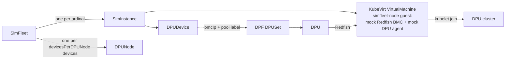

# DOCA Platform Scale Sim

[](LICENSE)
[](https://github.com/NVIDIA/doca-platform-scale-sim/actions/workflows/test.yml)
[](https://github.com/NVIDIA/doca-platform-scale-sim/actions/workflows/e2e.yml)
[](go.mod)

Simulate fleets of NVIDIA BlueField DPUs on Kubernetes, so the
[DOCA Platform Framework](https://github.com/NVIDIA/doca-platform) (DPF) can
be tested at scale without the hardware.

> [!IMPORTANT]
> This project is under active development. The `v1alpha1` API may change
> without notice, and only **zero-trust** DPF deployments are supported for
> now. No container images or Helm charts are published yet: build them from
> source as the [quick start](#quick-start) shows.

## Overview

A `SimFleet` asks for a number of DPUs. The controller backs each one with a
KubeVirt VirtualMachine that runs a mock Redfish BMC and a mock DPU agent, and
creates the DPF inventory objects (`DPUDevice`, `DPUNode`) DPF expects to find
for a real device. DPF then discovers, provisions and joins the simulated DPUs
through the same code paths it uses for hardware.

Use it to:

- Scale-test DPF provisioning across hundreds or thousands of DPUs.
- Exercise DPF changes in CI without BlueField hardware.
- Reproduce slow or outdated BMCs with Redfish response delays and firmware
  versions.
- Test your DPUServices on DPF: the simulated DPUs join the DPU cluster as
  nodes, so DPF deploys services to them as it would to hardware.

## How it works



1. The `SimFleet` controller rolls out one `SimInstance` per ordinal, in
   batches of 100, and one `DPUNode` for every `devicesPerDPUNode` devices.
2. Each `SimInstance` creates a `DPUDevice` and a VirtualMachine booting the
   `simfleet-node` guest image. Cloud-init gives the guest its mock BMC and
   DPU agent configuration and a per-ordinal management credential.
3. Once the VirtualMachine runs, the controller writes the guest's pod IP into
   the `DPUDevice` as `spec.bmcIp` and adds the fleet's
   `deviceSelectionLabels`.
4. A DPF `DPUSet` selecting those labels claims the device. DPF talks Redfish
   to the guest as it would to a BlueField BMC, and the guest joins the DPU
   cluster as a kubelet node with the join Secret DPF creates.

## Features

- Batched rollout, with failed instances replaced automatically.
- BlueField-3 and BlueField-4 device types.
- Configurable power-on firmware versions (BMC, ERoT, UEFI, NIC), to drive
  DPF's firmware upgrade paths.
- Per-operation Redfish response delays, to mimic slow BMCs.
- Mock reboot methods: `NoAction`, `PowerCycle`, `SLR`.
- Node selectors and tolerations to choose which cluster nodes run the guest
  VMs.
- Ordered teardown: deleting a fleet removes its VMs, DPF objects and Secrets.
- Progress at a glance: `kubectl get simfleet` shows admitted, provisioned and
  failed instances.

## Quick start

This walks through the
[zero-trust passthrough scenario](docs/scenarios/zero-trust-passthrough/README.md),
which installs the DPF objects (`BFB`, `DPUFlavor`, `DPUSet`, service chain)
and a matching `SimFleet`.

### Prerequisites

- A Kubernetes cluster running zero-trust DPF, with a Kamaji `DPUCluster`.
- `kubectl` and `helm` access to it.
- A container registry every cluster node can pull from.
- A Linux amd64 host with Docker, to build the guest image.
- Go 1.26, to build the controller and the mock DPU agent.
- A BFB that DPF can download from inside the cluster. Any BlueField bundle
  works; see the [common prerequisites](docs/scenarios/README.md#common-prerequisites).

### 1. Install KubeVirt

Skip this if KubeVirt v1.9.0 is already installed and configured as the
[KubeVirt configuration](docs/scenarios/README.md#kubevirt-configuration)
section describes.

```bash
docs/scenarios/zero-trust-passthrough/install-kubevirt.sh
```

### 2. Build and install the controller

```bash
make docker-build docker-push IMG=<registry>/simfleet-controller:<tag>
make deploy IMG=<registry>/simfleet-controller:<tag>
```

`make deploy` installs the Helm chart, CRDs included, into
`simfleet-controller-system`. See the
[chart README](charts/simfleet-controller/README.md) for every value.

### 3. Build the guest image

```bash
make dpuagent-build
make -C images/simfleet-node node-image-build node-image-push \
  NODE_IMG=<registry>/simfleet-node:<tag>
```

If the registry is private, pre-pull the image on every node as
[private guest image registries](docs/scenarios/README.md#private-guest-image-registries)
describes: KubeVirt pulls it anonymously.

### 4. Create a fleet

```bash
VM_IMAGE=<registry>/simfleet-node:<tag> \
BFB_URL=http://<server>/bf-bundle.bfb \
REPLICAS=10 \
  docs/scenarios/zero-trust-passthrough/install-passthrough-simfleet.sh
```

### 5. Watch it come up

```bash
kubectl -n dpf-operator-system get simfleet passthrough-fleet -w
kubectl -n dpf-operator-system get vmi,dpudevice,dpu
```

The fleet is ready when `InventoryReady`, `DPUsObserved`, `BootstrapReady` and
`VirtualMachinesReady` are True. DPU provisioning and the tenant nodes turning
Ready take a few more minutes; see
[SimFleet readiness](docs/scenarios/README.md#simfleet-readiness).

## Try it on Kind

`make test-e2e` creates a Kind cluster, installs DPF and KubeVirt, builds the
guest image and runs the end-to-end suite against a real `SimFleet`. It needs
a Linux amd64 host with Docker and `/dev/kvm`, and takes up to two hours.

```bash
make test-e2e
make cleanup-test-e2e
```

## Example SimFleet

```yaml
apiVersion: scale.dpu.nvidia.com/v1alpha1
kind: SimFleet
metadata:
  name: scale-100
  namespace: dpf-operator-system
spec:
  replicas: 100
  devicesPerDPUNode: 1
  deviceSelectionLabels:
    scale.dpu.nvidia.com/pool: scale-100
  bootstrap:
    dpuClusterRef:
      name: dpu-cplane-tenant1
      namespace: dpu-cplane-tenant1
  virtualMachineTemplate:
    image: <registry>/simfleet-node:<tag>
    resources:
      requests:
        cpu: "2"
        memory: 4Gi
  dpuNodeTemplate:
    metadata:
      labels:
        feature.node.kubernetes.io/dpu-enabled: "true"
  dpuAgent:
    dpuType: bf3
    bmc:
      responseDelay:
        minSeconds: 0
        maxSeconds: 1
      responseDelayOverrides:
        - name: UpdateService.SimpleUpdate
          minSeconds: 20
          maxSeconds: 30
```

A `DPUSet` whose `dpuDeviceSelector` matches
`scale.dpu.nvidia.com/pool: scale-100` and whose `dpuNodeSelector` matches
`feature.node.kubernetes.io/dpu-enabled: "true"` provisions these DPUs. The
[passthrough manifest](docs/scenarios/zero-trust-passthrough/passthrough-simfleet.yaml)
shows a complete set of DPF objects to pair with a fleet.

| Field                    | Purpose                                                                         |
| ------------------------ | ------------------------------------------------------------------------------- |
| `replicas`               | Number of simulated DPUs. Scale up or down at any time.                         |
| `devicesPerDPUNode`      | DPUs grouped under one `DPUNode`. Immutable.                                    |
| `deviceSelectionLabels`  | Labels published on each `DPUDevice` once its BMC is reachable.                 |
| `virtualMachineTemplate` | Guest image, resources and placement. Without it no guests boot.                |
| `dpuNodeTemplate`        | Labels and reboot method for each `DPUNode`.                                    |
| `dpuDeviceTemplate`      | Labels and number of PFs for each `DPUDevice`.                                  |
| `bootstrap`              | The `DPUCluster` the guests join.                                               |
| `dpuAgent`               | DPU type, reboot methods, BMC firmware and response delays. Immutable.          |

The full reference is in [`api/v1alpha1`](api/v1alpha1/simfleet_types.go).

## Documentation

- [Scale scenarios guide](docs/scenarios/README.md): guest image, private
  registries, KubeVirt settings, the mock DPU agent, nested networking,
  virtctl.
- [Zero-trust passthrough scenario](docs/scenarios/zero-trust-passthrough/README.md)
- [Helm chart values](charts/simfleet-controller/README.md)
- [Guest image build](images/simfleet-node/README.md)

## Development

```bash
make test     # unit and envtest tests, with the race detector
make lint     # golangci-lint
make verify   # generated code, CRDs, chart docs, shell formatting, copyright, checkov
```

`make verify` needs Docker. Run `make manifests generate` after changing the
API. See [CONTRIBUTING.md](CONTRIBUTING.md) for commit conventions and the
sign-off requirement.

## Contributing

Contributions are welcome. Open an issue before starting a significant change,
then send a pull request; see [CONTRIBUTING.md](CONTRIBUTING.md).

## Security

To report a vulnerability, follow [SECURITY.md](SECURITY.md). Do not open a
public issue.

## Support

Report bugs and ask questions in
[GitHub Issues](https://github.com/NVIDIA/doca-platform-scale-sim/issues).

## License

Apache License 2.0. See [LICENSE](LICENSE).
